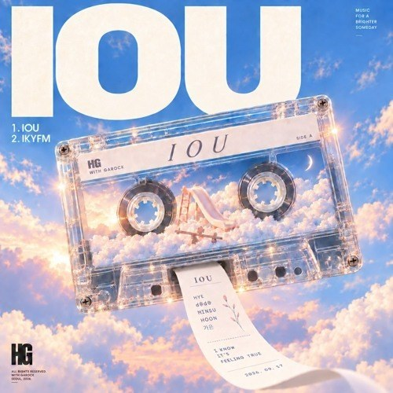

# SoundCloud NEED → IOU EP 교체 + 전체 디자인·코드 정비 ("Quiet Glass")

## 개요
SoundCloud 카드의 NEED를 빼고 최신 EP "IOU"(https://soundcloud.com/user-928451677/sets/iou)를 첫 칸에 넣는다.
함께 사이트 전체를 점검해, 겹쳐서 도는 장식 애니메이션, 보이지 않는 요소, 죽은 CSS/JS, 너무 작은 글자,
hover가 늦게 반응하는 버그를 정리한다. "움직이는 것이 많은" 상태를 "조용하지만 손에 반응하는" 링크트리로 바꾼다.

## 변경 유형
혼합 (HTML 콘텐츠 교체 + CSS 정비 + JS 함수 삭제 3개·추가 1개) → Evaluator는 **기능 변경 평가 기준**을 적용한다.

## 디자인 언어 & 의도
"Quiet Glass" — 배경과 히어로에서 계속 도는 애니메이션(그라디언트 시프트, halo 펄스, 링 호흡, 스크롤 바운스,
리플, 마우스 패럴랙스)을 걷어 내고, 코럴핑크 빛이 위에서 은은하게 내려오는 정적인 유리 표면을 만든다.
움직임은 사용자가 손을 댈 때만 생긴다: 카드 위 포인터를 따라가는 플랫폼 색 스포트라이트, 즉시 반응하는 hover,
필터를 바꿀 때 카드가 차례로 올라오는 등장. 히어로 맨 위에는 "New EP · IOU" 알약 하나만 두어 최신 작업을 먼저 보게 한다.

## Sprint 범위 계약
- **허용**: 이 SPEC 항목 구현에 꼭 필요한 최소 연동 변경 (삭제한 클래스의 reduced-motion·모바일·light 잔여물 제거,
  캐시 버전 갱신, docs/components.md·docs/css-rules.md 한두 줄 동기화).
- **금지**: SPEC에 없는 새 효과·섹션·카드·문구. 외부 링크 삭제. `.profile__motto`·`.profile__bio` 요소 삭제(스타일만 수정 가능).
  `:root` 기존 변수 삭제·값 변경. `assets/img/*` 추가·삭제. 카테고리 라벨 문구 변경. `select()`의 setTimeout 전환 로직 재작성.
- **판단 기준**: "이 변경이 없으면 SPEC 기능이 제대로 동작하지 않는가?" → YES면 허용, NO면 금지.

---

## 점검 결과 (근거)

| # | 현재 문제 | 근거 | 조치 |
|---|---|---|---|
| A1 | 히어로 고정 배경이 거의 같은 두 남색(#1a1a2e→#16213e)을 400% 크기로 15초마다 무한 이동. 거의 안 보이는데 전체 레이어를 계속 다시 그림. 브랜드 밖 하드코딩 색 | `.hero-bg`, `html.light .hero-bg` | 브랜드 토큰 정적 레이어로 교체 (§3-1) |
| A2 | `.profile__halo`가 `.hero-bg`(fixed, z:0) 아래(z:-1)에 그려져 실제로 보이지 않는데 무한 펄스 | `.profile__halo` | 요소·CSS·keyframes 삭제 |
| A3 | reduced-motion에서 히어로 텍스트 스택 컨텍스트가 사라져 고정 배경 아래로 깔릴 수 있음 (추정) | reduced-motion 블록 + `.hero` | `.hero { position:relative; z-index:1 }` |
| A4 | `avatar-ring-breathe`가 opacity를 애니메이션 → `:hover::before { opacity:.9 }` 절대 적용 안 됨 | `.profile__avatar-wrap::before` | breathe 삭제, 회전만 유지 |
| A5 | `.scroll-hint` 부모에 position이 없어 첫 뷰포트 하단에 붙고, 모바일에선 모토/바이오 위에 겹침. 무한 바운스 | `.scroll-hint`, `.hero` | 요소·CSS·keyframes·`initHeroParallax` 삭제. 히어로 높이를 콘텐츠에 맞춰 탭이 살짝 보이게 |
| A6 | `.profile__hint`("프로필 확인")가 Profile 버튼과 중복, 음수 margin 핵 | index.html, style.css | 요소·CSS 삭제 |
| A7 | 모토 컨테이너 등장(0.68s)보다 `initMottoReveal` 개별 등장(0/150/300ms)이 먼저 끝나 stagger가 안 보임 | main.js, style.css | JS 삭제, CSS nth-child 지연으로 대체 |
| A8 | `.link-card:nth-child(n)`·`.featured-item:nth-child(n)`의 transition-delay가 hover에도 걸려 반응이 최대 0.24s 늦음 | style.css | 등장을 keyframes로, transition-delay 삭제 |
| A9 | `html.light .link-card:hover`(0,3,1)가 `.link-card:has(.icon--x):hover`(0,3,0)를 이겨 라이트에서 플랫폼 글로우 전무 | style.css | 오버라이드 삭제, `--card-glow` 한 변수로 |
| A10 | 카드 hover가 border/background를 transition 목록에만 두고 바꾸지 않음 | `.link-card:hover` | hover에 border/background 추가 |
| A11 | 썸네일 hover에 translateY(-3px)+scale(1.02)+img scale(1.08)+0.5 alpha 그림자 중복 | `.featured-item:hover` | lift 2px + img 1.04 + 토큰 그림자 |
| A12 | hover 번호 배지(1/2/3)가 순서 없는 항목에 번호를 붙임 | `.featured-item::before`, counter | 전부 삭제 |
| A13 | 글자 과소: label 10.5px(모바일 9.5), motto-kr 9px(모바일 8px), motto-word 10px(모바일 9px) | style.css | 최소 10~12px 체계 |
| A14 | `.section-label`이 세리프 11px 대문자 + clip-path 와이프 + 죽은 `::before` | `.section-label` | 산세리프 12px, 단순 페이드 |
| A15 | 탭 클릭 시 리플+스프링 인디케이터+lift+drop-shadow 중복 | `addRipple`, `.ripple` | 리플 삭제 |
| A16 | `initMouseParallax`는 A1 이후 효과 없음 | main.js | 삭제 |
| A17 | 죽은 CSS: `dot-pulse`·`fadeInUp` keyframes, `.hero-bg img`, `.category-section` max-height transition, 모바일 중복 규칙, `.profile {margin-bottom:0; padding-top:0}`, HTML `.link-card--app` | 각 위치 | 삭제 |
| A18 | 반경 제각각: 액션 6 / 탭 999 / 모토 6 / 바이오 10 / 모달 24 | style.css | `--radius-pill` 추가, 모달 → `--radius-lg`, 모토 → `--radius` |
| A19 | 푸터 아이콘 터치 대상 24px 미만, scale(1.15)+drop-shadow 과함, aria-hidden 없음 | 푸터 | 40px 원형 타깃 + 2px lift |
| A20 | 라이트 해 아이콘 `#f0c040` 흰 배경 대비 약 1.6:1, 하드코딩 | `.theme-toggle__icon--light` | `--theme-sun` 토큰 |
| A21 | `html.light .featured-item { background:#f0eff4 }` 하드코딩 | style.css | `--bg-item` 토큰 |
| A22 | SoundCloud 헤더 href에 utm 파라미터 잔존 | index.html | `https://soundcloud.com/user-928451677` |
| A23 | `.modal-close`에 type 없음, 테마 토글·모달 닫기 `<i>` aria-hidden 없음 | index.html | 속성 추가 |

**보호 대상**: `--brand-text`/`--text-dim` 대비 토큰, radiogroup + roving tabindex, `height:auto` 이미지 규칙,
`.profile__motto`·`.profile__bio` 요소와 문구(타이핑 포함), 아바타 `role="button"` + 키보드, FOUC 인라인 스크립트,
Velog/GitHub fetch, 모달 포커스 트랩, `initNameShine`, `initTyping`, `initScrollProgress`, 카테고리 라벨 문구.

---

## 변경 범위

### index.html
1. **테마 토글 이동**: `<button class="theme-toggle js-theme-toggle">`를 `.hero` 밖, `<div class="scroll-progress">` 바로 다음(body 직계)으로. 두 `<i>`에 `aria-hidden="true"`. (`.hero`가 z-index:1 컨텍스트가 되면 안쪽 fixed 토글이 갇힘)
2. `<div class="hero-bg"></div>` 유지 + `aria-hidden="true"`.
3. **삭제**: `.profile__halo`, `.profile__hint`, `.scroll-hint` 요소.
4. **eyebrow → 최신 릴리즈 알약**:
   ```html
   <a class="profile__eyebrow" href="https://soundcloud.com/user-928451677/sets/iou" target="_blank" rel="noopener">
     <span class="profile__eyebrow-dot" aria-hidden="true"></span>
     New EP · IOU
     <i class="fa-solid fa-arrow-right profile__eyebrow-arrow" aria-hidden="true"></i>
   </a>
   ```
   aria-label 없음 (보이는 텍스트가 접근성 이름, WCAG 2.5.3).
5. `.profile__dot` span 2개 유지 (CSS로 색만).
6. **SoundCloud 카드**:
   - 헤더 href → `https://soundcloud.com/user-928451677`
   - NEED `<a>` 블록(need-feat-sumin / cover-need.jpg) 삭제
   - `.link-card__items` **첫 번째 자식**으로:
   ```html
   <a class="featured-item" href="https://soundcloud.com/user-928451677/sets/iou" target="_blank" rel="noopener" aria-label="IOU EP SoundCloud에서 듣기">
     
     <div class="featured-item__label">IOU</div>
     <div class="featured-item__meta">
       <span class="featured-item__source">EP</span>
     </div>
   </a>
   ```
   최종 순서: IOU → 악어는 하늘을 나는 꿈을 꾸었다 → Burn It Up.
7. App Store 카드 `class="link-card link-card--app"` → `class="link-card"`.
8. 푸터 `<i>` 4개에 `aria-hidden="true"`.
9. 모달 `.modal-close`에 `type="button"`, 내부 `<i>`에 `aria-hidden="true"`.
10. 캐시 버전: style.css / main.js `?v=20260728-1` → `?v=20260923-1`.

### assets/css/style.css

#### 3-0. 새 토큰 (`:root`와 `html.light`)
| 토큰 | :root | html.light |
|---|---|---|
| `--radius-pill` | `999px` | (상속) |
| `--shadow-card-hover` | `0 6px 24px rgba(0,0,0,0.25)` | `0 6px 20px rgba(0,0,0,0.08)` |
| `--shadow-item-hover` | `0 6px 18px rgba(0,0,0,0.28)` | `0 6px 16px rgba(0,0,0,0.10)` |
| `--bg-item` | `#09080f` | `#f0eff4` |
| `--theme-sun` | `#f0c040` | `#a8650f` |
| `--spot-size` | `260px` | (상속) |

`999px` 리터럴(`.category-nav`, `__indicator`, `__btn`, `.featured-item__source`) → `var(--radius-pill)`.

#### 3-1. 히어로 배경·레이어
- `.hero-bg`: `animation`·`background-size`·`& img`·`&::after` 삭제, `pointer-events:none` 추가. background:
  ```css
  background:
    radial-gradient(90% 60% at 50% 0%, var(--brand-14) 0%, transparent 70%),
    linear-gradient(180deg, var(--bg-dark) 0%, var(--bg) 100%);
  ```
- `html.light .hero-bg` 블록 삭제. `@keyframes gradient-shift` 삭제.
- `.hero`: `position:relative; z-index:1;` 추가, `overflow:hidden` 삭제, `min-height` 두 줄 삭제. padding → `clamp(42px, 6vh, 84px) 24px clamp(40px, 6vh, 72px)`.
- `@media (min-width:900px) .hero`: min-height 삭제, `padding-bottom: clamp(48px, 7vh, 80px)`.
- 모바일 `.hero`: `padding: 48px 16px 40px;`만 (height/min-height/overflow 삭제).
- `.scroll-hint` 블록, `@keyframes scroll-bounce`·`halo-pulse`·`dot-pulse`·`avatar-ring-breathe`·`fadeInUp` 삭제. `.profile__halo` 블록 삭제.

#### 3-2. 프로필(히어로)
- `.profile`: `margin-bottom:0; padding-top:0` 삭제. 모바일 `.profile { margin-bottom:36px }` 삭제.
- 아바타 링 `::before`: `animation: avatar-ring-rotate 12s linear infinite;`만 → hover opacity 0.9 작동.
- `.profile__hint` 관련 규칙 전부 삭제.
- **`.profile__eyebrow` 알약** (`.profile` 안 중첩):
  ```
  display:flex; align-items:center; gap:8px; width:max-content; max-width:100%;
  margin:0 auto 14px;   /* 블록 레벨 — inline이면 아바타와 같은 줄에 붙음 */
  min-height:32px; padding:0 14px 0 12px;
  border:1px solid var(--brand-25); border-radius:var(--radius-pill);
  background:var(--brand-08); backdrop-filter + -webkit-backdrop-filter: blur(14px) saturate(1.1);
  font-size:11px; font-weight:700; letter-spacing:1.6px; text-transform:uppercase;
  color:var(--brand-text); text-decoration:none;
  transition: background 0.25s, border-color 0.25s, box-shadow 0.25s;
  &:hover { background:var(--brand-14); border-color:var(--brand-40); box-shadow:0 4px 16px var(--brand-14);
            & .profile__eyebrow-arrow { transform:translateX(3px); } }
  ```
  - 알약 자체에는 hover transform 금지 (heroEntrance fill `both`가 transform을 붙잡음).
  - `.profile__eyebrow-dot`: 6px 원, `background:var(--brand)`, `box-shadow:0 0 0 3px var(--brand-20)`, 애니메이션 없음.
  - `.profile__eyebrow-arrow`: `font-size:10px; transition: transform 0.25s;`
  - 모바일: `font-size:10px; letter-spacing:1.6px` 유지.
- `.profile__dot`: `color: var(--brand-text); margin: 0 2px;`
- `.profile__action`: `border-radius: var(--radius-pill)`, `padding: 0 18px`. `--primary`: `background:var(--brand-14); border-color:var(--brand-40)`.
- **모토**:
  - `.profile__motto-item`: `opacity:0; transform:translateY(12px)`와 `&.is-visible` 삭제. transition은 `border-color var(--transition), box-shadow var(--transition)`만. `border-radius: var(--radius)`.
  - `.profile__motto-back`: `border-radius: var(--radius)`.
  - `.profile__motto-front`·`.profile__motto-back`에 `-webkit-backface-visibility: hidden;`.
  - 타이포: motto-word 11px(모바일 10px, letter-spacing 0.8px) / motto-kr 11px(모바일 10px) / motto-back-text 12px(모바일 11px).
- `.profile__bio`: `padding: var(--card-pad-y) var(--card-pad-x);`, 모바일 `.profile__bio { padding:24px 24px }` 삭제.
- **히어로 등장 시퀀스** (heroEntrance, duration·이징 유지, 지연만):
  avatar-wrap 0s / eyebrow 0.08s / name 0.14s / subtitle 0.20s / statement 0.26s / actions 0.32s /
  `.hero .profile__motto-item:nth-child(1|2|3)` 0.38s·0.44s·0.50s / bio 0.58s. `.hero .profile__motto`(컨테이너) 애니메이션 블록 삭제.
- `html.light .profile__name`·`html.light .modal-name`의 `#1a1a2e` → `var(--text)`.
- 모바일 블록의 `.hero .profile__name`, `.hero .profile__motto`, `.hero .profile__bio` 줄 삭제.

#### 3-3. 카테고리 탭·섹션 헤더
- `.category-nav__btn`: `padding: 10px 16px; gap: 6px; font-size: 13px;`, `overflow: hidden` 삭제, 아이콘 16px. 모바일 btn `padding: 14px 16px`. 521px 확장 규칙 유지.
- `.category-section`: transition 선언 삭제.
- `.section-label`: `font-family: var(--font); font-size:12px; font-weight:500; letter-spacing:0.2px; text-transform:none;` transform translateY(8px)·clip-path 삭제, transition `opacity 0.5s ease-out, transform 0.5s ease-out`. `&::before` 삭제. `.category-header` 안 재정의·`::before{display:none}` 삭제 (base: margin 0, padding 0).
- reduced-motion `.section-label { clip-path:none }` 삭제.

#### 3-4. 링크 카드 & 썸네일
- **등장을 keyframes로**:
  ```css
  .link-card {
    opacity: 0;
    transition: transform var(--transition), background-color var(--transition),
                border-color var(--transition), box-shadow var(--transition);
    &.is-visible { opacity: 1; animation: card-rise 0.6s var(--ease-out-expo) backwards; }
    &.is-visible:nth-child(2) { animation-delay: 0.08s; }
    &.is-visible:nth-child(3) { animation-delay: 0.16s; }
  }
  @keyframes card-rise { from { opacity: 0; transform: translateY(16px); } }
  ```
  fill-mode 반드시 `backwards` (`both`/`forwards`는 hover lift를 막음). 기존 transition-delay 3줄, 기본 `transform: translateY(24px)` 삭제.
- **글로우 변수화**:
  ```css
  .link-card {
    --card-glow: var(--brand-14);
    &:has(.icon--velog) { --card-glow: var(--glow-velog); }
    … brunch / github / melon / soundcloud / app / instagram / instagram2(→ --glow-instagram) / naver …
    &:hover {
      transform: translateY(-2px);
      border-color: var(--border-hover);
      background-color: var(--bg-card-hover);
      box-shadow: var(--shadow-card-hover), 0 6px 24px var(--card-glow);
    }
  }
  ```
  기존 `&:has(...):hover` 10줄과 `html.light .link-card:hover` 삭제.
- **카드 스포트라이트**:
  ```css
  &::after {
    content: ''; position: absolute; inset: 0; border-radius: inherit;
    pointer-events: none; z-index: 0; opacity: 0;
    background: radial-gradient(var(--spot-size) circle at var(--spot-x, 50%) var(--spot-y, 0%),
                var(--card-glow), transparent 70%);
    transition: opacity var(--transition);
  }
  &:hover::after { opacity: 1; }
  ```
- `.link-card__desc`: `font-size: 13px`.
- **`.featured-item`**:
  - `background: var(--bg-item)`, `html.light .featured-item` 삭제.
  - counter-increment, `&::before`, `&:hover::before`, `counter-reset`, 모바일/reduced-motion/feature의 `::before` 전부 삭제.
  - `&:nth-child(n) { transition-delay }` 삭제.
  - hover: `border-color: var(--border-hover); transform: translateY(-2px); box-shadow: var(--shadow-item-hover);`, 썸네일 `scale(1.04)`.
  - `__label`: `font-size:12px; -webkit-line-clamp:2; overflow-wrap:anywhere; padding:8px 10px;` (모바일 11px, `6px 8px`).
  - `__meta`: `padding: 0 10px 10px;`, 모바일 `font-size:10px`.
  - `.link-card--feature` 안 `& .featured-item__label { font-size:12px }` 삭제.

#### 3-5. 기타
- `.theme-toggle`: hover `transform: translateY(-1px)`, `box-shadow: var(--shadow-card-hover)`. `--light` 아이콘 `color: var(--theme-sun)`.
- `.ripple`, `@keyframes ripple-expand` 삭제.
- `.modal-box`: `border-radius: var(--radius-lg)`.
- **푸터**: `.footer__social { gap: 8px; }`, `a { display:inline-flex; align-items:center; justify-content:center; width:40px; height:40px; border-radius:var(--radius-pill); border:1px solid transparent; color:var(--text-dim); font-size:16px; transition: color, background, border-color, transform (var(--transition)); &:hover { color:var(--brand-text); background:var(--focus-pill-bg); border-color:var(--border); transform:translateY(-2px); } }` — filter/drop-shadow/scale 삭제.
- **reduced-motion 정리**:
  - 삭제: `.hero-bg`, `.scroll-hint`, `.profile__hint`, `.section-label{clip-path}`, `.featured-item::before`, `.profile__motto-item &:hover{transform:none}`.
  - `.hero .profile__motto` → `.hero .profile__motto-item`.
  - 추가: `.link-card.is-visible { animation: none; }`, `.link-card::after { display: none; }`, `.profile__avatar-wrap::before { animation: none; }`, `.footer__social a:hover { transform: none; }`.

### assets/js/main.js
1. 삭제: `initMouseParallax`, `initHeroParallax`, `initMottoReveal` 본문과 각 `safeInit(...)`.
2. `initCategoryFilter`: `addRipple`과 호출 삭제. `btn.addEventListener('click', () => select(btn));`. JSDoc → "페이드 전환 + 섹션 필터 초기화". `select()`와 키보드 로직은 그대로.
3. 추가 `initCardSpotlight()` (섹션 구분선 + JSDoc, `initNameShine` 다음):
   ```js
   function initCardSpotlight() {
     const root = document.querySelector('.page-wrapper');
     if (!root) return;
     if (window.matchMedia('(hover: none)').matches) return;
     if (window.matchMedia('(prefers-reduced-motion: reduce)').matches) return;

     let frame = 0;
     let last = null;
     // pointermove는 연속 발화하므로 프레임 단위로 합친다
     root.addEventListener('pointermove', (e) => {
       if (e.pointerType === 'touch') return;
       last = e;
       if (frame) return;
       frame = requestAnimationFrame(() => {
         frame = 0;
         const card = last.target.closest('.link-card');
         if (!card) return;
         const rect = card.getBoundingClientRect();
         card.style.setProperty('--spot-x', `${last.clientX - rect.left}px`);
         card.style.setProperty('--spot-y', `${last.clientY - rect.top}px`);
       });
     }, { passive: true });
   }
   ```
   `safeInit(initCardSpotlight, 'initCardSpotlight');` 등록.

### docs 동기화
- `docs/components.md`: 프로필 행 JS → `initTyping()` `initNameShine()`, "그 외 컴포넌트"에 `initCardSpotlight()` 한 줄.
- `docs/css-rules.md` §5: 카드 글로우를 `--card-glow` 방식으로, §7: "link-card는 `card-rise` keyframes (fill-mode backwards)".

---

## 기능 상세
### 기능 1: IOU EP 교체
- NEED 제거, IOU를 SoundCloud 카드 첫 칸에. 히어로 알약도 같은 EP로 연결. 라벨 "IOU", 배지 "EP", alt "IOU EP 커버".
- **cover-need.jpg**: 참조는 index.html 한 곳뿐. Generator는 삭제하지 않는다 (assets/img 읽기 전용). 합격 후 메인 에이전트가 grep 확인 뒤 `git rm`. `cover-iou.jpg`는 커밋 시 `git add`.
### 기능 2: Quiet Glass 배경·히어로 — §3-1, §3-2, JS 삭제 3건
### 기능 3: 카드 인터랙션 재정비 — §3-4, `initCardSpotlight`
### 기능 4: 타이포·여백·접근성 — §3-2, §3-3, §3-5, HTML §8·§9

---

## 주의사항
- 삭제 후 3파일 grep 0건: `profile__halo`, `profile__hint`, `scroll-hint`, `scroll-bounce`, `halo-pulse`, `dot-pulse`, `fadeInUp`, `gradient-shift`, `avatar-ring-breathe`, `ripple`, `addRipple`, `initMouseParallax`, `initHeroParallax`, `initMottoReveal`, `feat-counter`, `link-card--app`, `need-feat-sumin`, `cover-need`.
- 정의 없는 `var(--*)` 0건 (`--card-glow`는 `.link-card` 안에서 정의, `--spot-x/y`는 fallback 있음). `game.css`는 삭제 대상을 참조하지 않음.
- `heroEntrance` fill `both`가 transform을 붙잡으므로 히어로 직계 애니메이션 요소(eyebrow, motto-item)에 hover transform 금지.
- `.link-card` 등장은 반드시 `backwards`.
- 테마 토글을 `.hero` 밖으로 옮기지 않으면 z-index:1 컨텍스트에 갇힌다.
- `tests/ui-check.js` 셀렉터는 전부 유지되므로 테스트 수정 불필요.
- 새 `<a target="_blank">` 2개 모두 `rel="noopener"`.
- 대비: `.section-label` 12px `--text-dim` 다크 약 4.9:1, 라이트 약 5.3:1. 알약은 `--brand-text`. EP 배지는 기존 `.featured-item__source` 재사용.
- 520px: 모토 3열에서 "CONFRONTATION" 10px + letter-spacing 0.8px가 한 줄에 들어가는지 확인.
